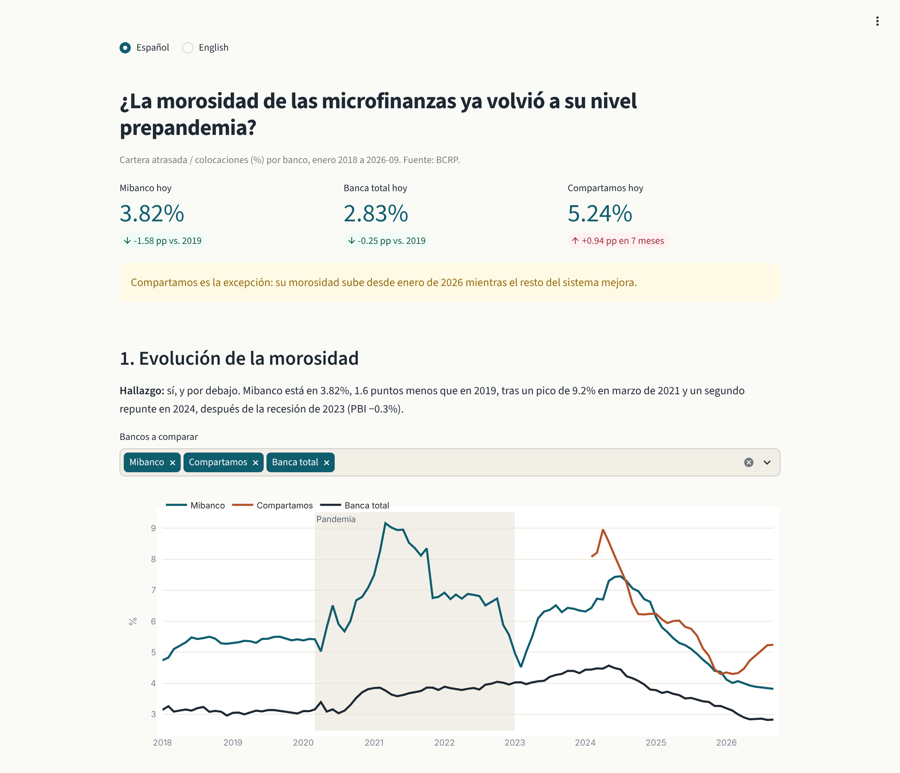

# ¿La morosidad de las microfinanzas ya volvió a su nivel prepandemia?

**ES** · [EN below](#english)

Análisis de la cartera atrasada de la banca peruana (enero 2018 a septiembre 2026) con datos públicos del Banco Central de Reserva del Perú, con foco en los bancos especializados en microfinanzas: Mibanco y Compartamos.



## Respuestas en 30 segundos

| Pregunta de negocio | Respuesta |
| --- | --- |
| ¿Volvió la morosidad de las microfinanzas a su nivel prepandemia? | Sí, y por debajo. Mibanco está en 3.82%, 1.6 puntos menos que el promedio de 2019 (5.40%), tras un pico de 9.16% en marzo de 2021. |
| ¿Se cerró la brecha con la banca tradicional? | Sí. La diferencia frente a la banca total bajó de 2.3 puntos en 2019 a 1.0 en 2026. |
| ¿Hay alguna señal de alerta? | Compartamos: su morosidad sube de 4.30% en febrero a 5.24% en septiembre de 2026, mientras el sistema mejora. |
| ¿El desempleo anticipa la morosidad? | Con 6 meses de adelanto, la correlación es 0.76, pero baja a 0.31 sin el periodo de pandemia. Sirve como alerta temprana, no como predictor por sí solo. |
| ¿Se puede pronosticar a 6 meses? | No mucho mejor que repetir el último dato: el error del ARIMA es 0.50 puntos frente a 0.52 del método ingenuo, en 39 pronósticos sucesivos. |

## Gobierno y calidad de datos

- **Quiebre metodológico detectado:** antes de enero de 2018 el BCRP publicaba esta serie neta de provisiones (con valores negativos). El análisis usa solo el tramo comparable, desde 2018.
- **Controles automáticos:** `src/quality.py` marca saltos de más de 1 punto en un mes. El de BCP en septiembre de 2026 (2.67% a 4.04%) queda marcado para validarse antes de usarse en decisiones.
- **Trazabilidad:** cada número del dashboard sale de `src/analysis.py`, a partir de los CSV descargados por `src/download.py`.

## Cómo reproducirlo

```bash
python -m venv .venv && source .venv/bin/activate
pip install -r requirements.txt
python src/download.py          # descarga los datos del BCRP (sin API key)
streamlit run app/app.py        # abre el dashboard
pip install -r requirements-dev.txt && pytest
```

## Estructura

```
src/download.py    descarga de series del BCRP
src/analysis.py    métricas de negocio y backtest
src/quality.py     controles de calidad de datos
app/app.py         dashboard bilingüe en Streamlit
data/raw/          datos descargados (CSV)
tests/             pruebas
```

## Limitaciones

- Datos agregados por banco. No incluye cajas municipales ni detalle por región o tipo de crédito.
- Correlación no es causalidad. El periodo sin pandemia deja unos 50 meses de datos.

---

<a id="english"></a>

## English

**Has microfinance delinquency in Peru returned to pre-pandemic levels?** An analysis of past-due loan ratios for Peruvian banks (January 2018 to September 2026) using public data from the Central Reserve Bank of Peru (BCRP), focused on the two microfinance banks, Mibanco and Compartamos.

| Business question | Answer |
| --- | --- |
| Back to pre-pandemic levels? | Yes, and lower. Mibanco is at 3.82%, 1.6 points below its 2019 average (5.40%), after a 9.16% peak in March 2021. |
| Has the gap with traditional banks closed? | Yes. The gap with the banking system fell from 2.3 points in 2019 to 1.0 in 2026. |
| Any warning signs? | Compartamos: its delinquency rose from 4.30% in February to 5.24% in September 2026 while the system improved. |
| Does unemployment lead delinquency? | At a 6-month lead the correlation is 0.76, but only 0.31 excluding the pandemic. An early warning, not a standalone predictor. |
| Can we forecast 6 months ahead? | Barely better than repeating the last value: ARIMA error 0.50 points vs. 0.52 for the naive method, across 39 rolling forecasts. |

**Data governance:** a methodology break before 2018 was detected and excluded; automated checks flag single-month jumps above 1 point (BCP, September 2026).

---

Autor / Author: **Ricardo Dulanto** · [LinkedIn](https://www.linkedin.com/in/rdulanto/) · Licencia MIT.
